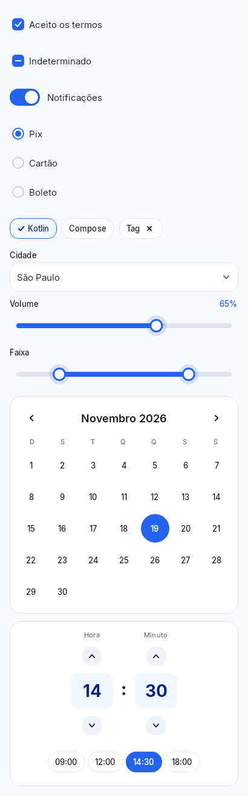
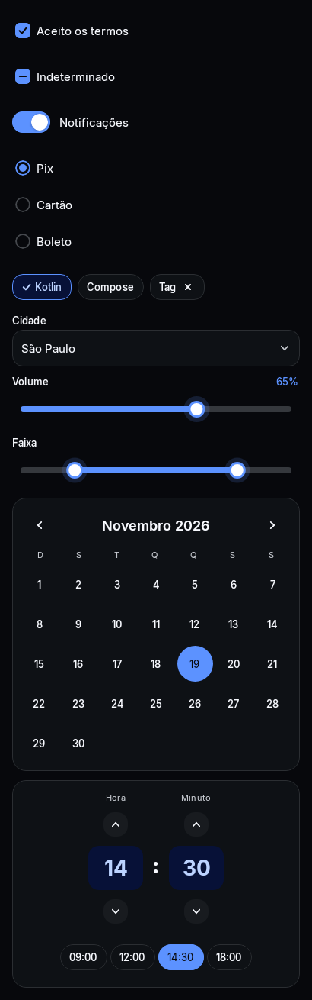
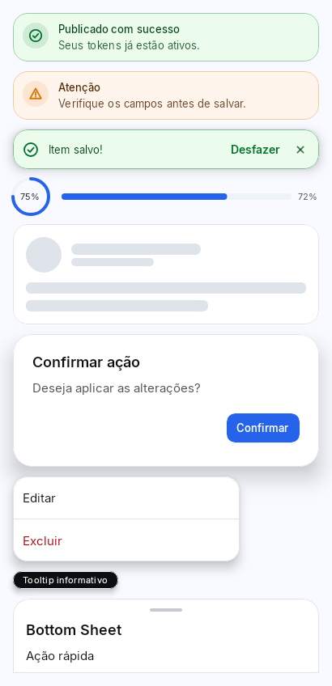
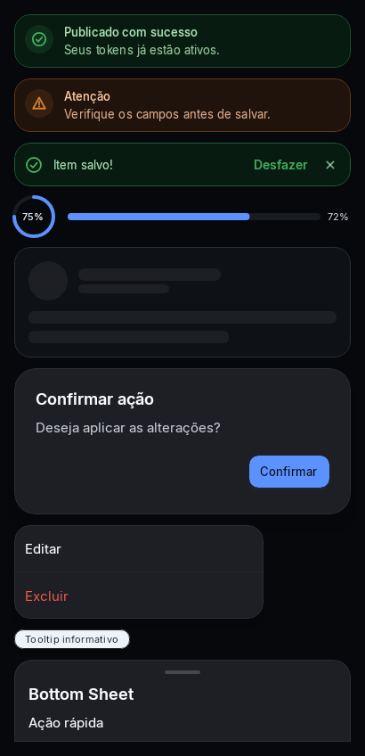
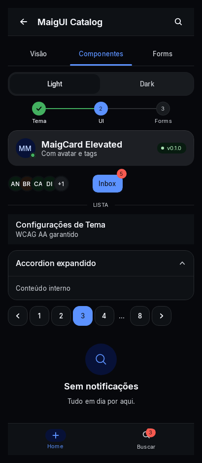
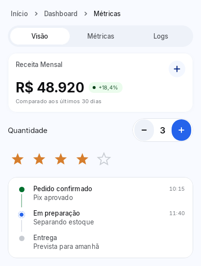

<div align="center">

# MaigUI

**Bootstrap-style Design System & UI Component Library for Jetpack Compose**

Add one dependency, wrap your app in `MaigTheme {}`, and ship consistent, accessible, modern Android UIs in minutes — **100% built on `androidx.compose.foundation`** with zero Material 3 visual lock-in.

[](https://github.com/Maignardi/MaigUI/actions/workflows/ci.yml)
[](LICENSE)
[](gradle/libs.versions.toml)
[](gradle/libs.versions.toml)
[](https://jitpack.io/#Maignardi/MaigUI)

[Interactive Docs & Component Explorer](https://maignardi.github.io/MaigUI/) • [Sample Catalog App](sample) • [Brazilian Forms & Masks](maigui-forms)

</div>

---

## Why MaigUI?

- **Zero Material 3 look-and-feel**: Crafted directly on `androidx.compose.foundation` (`Canvas`, `BasicText`, `BasicTextField`, `Popup`, `Dialog`) for crisp, predictable cross-brand styling.
- **Single-color WCAG AA Palette Engine**: Pass `MaigBrand(primary = Color(0xFF...))` and MaigUI generates full `50–900` tonal scales in **OKLCH** for both Light & Dark themes, mathematically guaranteeing `>= 4.5:1` WCAG AA contrast on all `"on"` colors.
- **40+ Ready-to-Use Components**: Buttons, Inputs, Selection controls, Pickers, Dialogs, Bottom Sheets, Toasts, Skeletons, Navigation, Cards, Avatars, and Scaffolds — all following official Compose API conventions (`modifier` first optional param, `XxxDefaults`, `enabled`, `interactionSource`, 48dp touch targets, semantics, and Light/Dark `@Preview`).
- **Declarative Brazilian Forms (`maigui-forms`)**: `rememberMaigForm {}` with `rememberSaveable` rotation survival, automatic `ImeAction.Next`/`Done` focus chaining, real mod-11 CPF & CNPJ validation, CEP, Brazilian phone, and `VisualTransformation` masks.
- **Bundled Inter Typography**: Ships with Inter (`Regular`, `Medium`, `SemiBold`, `Bold` — SIL OFL) and lets you swap `fontFamily` in one line.
- **Battle-tested Quality**: `explicitApi()`, Binary Compatibility Validator (`apiCheck`), Dokka, unit tests, Robolectric Compose UI tests, and Roborazzi Light & Dark screenshot tests.

---

## Visual Gallery (Rendered Compose UI)

> Generated directly from our Compose UI test suite via **Roborazzi** (`./gradlew :maigui-components:verifyRoborazziDebug`).

<table>
  <tr>
    <th>Buttons &amp; Actions (Light)</th>
    <th>Buttons &amp; Actions (Dark)</th>
  </tr>
  <tr>
    <td align="center"></td>
    <td align="center"></td>
  </tr>
  <tr>
    <th>Inputs &amp; Specialized Fields (Light)</th>
    <th>Inputs &amp; Specialized Fields (Dark)</th>
  </tr>
  <tr>
    <td align="center"></td>
    <td align="center"></td>
  </tr>
  <tr>
    <th>Selection &amp; Pickers (Light)</th>
    <th>Selection &amp; Pickers (Dark)</th>
  </tr>
  <tr>
    <td align="center"></td>
    <td align="center"></td>
  </tr>
  <tr>
    <th>Overlays &amp; Feedback (Light)</th>
    <th>Overlays &amp; Feedback (Dark)</th>
  </tr>
  <tr>
    <td align="center"></td>
    <td align="center"></td>
  </tr>
  <tr>
    <th>Display &amp; Navigation (Light)</th>
    <th>Display &amp; Navigation (Dark)</th>
  </tr>
  <tr>
    <td align="center"></td>
    <td align="center"></td>
  </tr>
  <tr>
    <th>Modern Dashboard &amp; Extras (Light)</th>
    <th>Modern Dashboard &amp; Extras (Dark)</th>
  </tr>
  <tr>
    <td align="center"></td>
    <td align="center"></td>
  </tr>
</table>

---

## Installation

### Option 1 — Direct from GitHub (JitPack)

Add JitPack to your `settings.gradle.kts`:

```kotlin
dependencyResolutionManagement {
    repositories {
        google()
        mavenCentral()
        maven("https://jitpack.io")
    }
}
```

Then add MaigUI to your module `build.gradle.kts`:

```kotlin
dependencies {
    // Components + Core (MaigTheme & tokens included transitively via api)
    implementation("com.github.Maignardi.MaigUI:maig-ui:0.1.0")

    // Optional: Declarative forms, masks & Brazilian validators
    implementation("com.github.Maignardi.MaigUI:maig-ui-forms:0.1.0")

    // Optional: Tokens & theme only
    // implementation("com.github.Maignardi.MaigUI:maig-ui-core:0.1.0")
}
```

### Option 2 — Maven Central

```kotlin
dependencies {
    implementation("io.github.maignardi:maig-ui:0.1.0")
    implementation("io.github.maignardi:maig-ui-forms:0.1.0")
}
```

---

## Modules

| Module | Artifact | Description |
| :--- | :--- | :--- |
| `maigui-core` | `maig-ui-core` | `@Immutable` tokens, OKLCH palette generator, WCAG AA contrast utilities, 4 presets, Inter typography |
| `maigui-components` | `maig-ui` | All UI components + built-in `MaigIcons` (exposes `maigui-core` via `api`) |
| `maigui-forms` | `maig-ui-forms` | `rememberMaigForm`, validators (including CPF/CNPJ/CEP/BR Phone), `MaigMasks`, focus-linked fields |
| `sample` | — | Interactive catalog & testing app with live Light/Dark and real-time brand color switching |

---

## Quick Start & Theme Setup

Wrap your root composable in `MaigTheme {}`. By default it respects `isSystemInDarkTheme()` and uses the `MaigThemes.Default` cobalt blue palette with Inter typography:

```kotlin
@Composable
fun MyApp() {
    MaigTheme {
        val toast = LocalMaigToastState.current

        MaigScaffold(
            topBar = { MaigTopBar(title = "My App") },
        ) { padding ->
            Column(
                modifier = Modifier
                    .padding(padding)
                    .padding(MaigTheme.spacing.lg),
            ) {
                MaigCard {
                    Text(
                        text = "Welcome to MaigUI",
                        style = MaigTheme.typography.title,
                    )
                    MaigSpacer.md()
                    MaigButton(
                        text = "Get Started",
                        onClick = { toast.showSuccess("Ready to build!") },
                        fullWidth = true,
                    )
                }
            }
        }
    }
}
```

### Customizing Brand Colors & Fonts

Generate an entire Light & Dark WCAG AA theme from **one single color**:

```kotlin
MaigTheme(
    brand = MaigBrand(primary = Color(0xFFE11D48)),
    darkTheme = isSystemInDarkTheme(), // or force true / false
    fontFamily = MyCustomFontFamily,   // overrides Inter across all 10 text styles
) {
    // Access tokens anywhere via MaigTheme.*
    // MaigTheme.colors.primaryDefault / primarySubtle / surface / textPrimary ...
    // MaigTheme.typography.displayLarge .. button
    // MaigTheme.spacing.xxs .. xxxl
    // MaigTheme.shapes.none .. full
    // MaigTheme.elevation.none .. xl
}
```

Or pick one of the **10 curated designer presets** (`Default`, `Indigo`, `Purple`, `Rose`, `Crimson`, `Orange`, `Amber`, `Green`, `Teal`, `Slate`):

```kotlin
MaigTheme(preset = MaigThemes.Purple) { /* ... */ }
```

---

## Component Catalog

| Category | Components |
| :--- | :--- |
| **Buttons** | `MaigButton` (`Solid`, `Outline`, `Ghost`, `Soft`, `Link` × 6 semantic colors × 3 sizes, loading, icons, `fullWidth`, spring press feedback), `MaigIconButton`, `MaigFab`, `MaigButtonGroup` |
| **Inputs** | `MaigTextField` (`Outlined`, `Filled`, focus halo, helper/error, counter), `MaigPasswordField`, `MaigSearchField`, `MaigTextArea`, `MaigOtpField`, `MaigMoneyField` (`R$`), `MaigPhoneField`, `MaigNumberStepper` |
| **Selection** | `MaigCheckbox`, `MaigTriStateCheckbox` (indeterminate), `MaigRadioButton`, `MaigRadioGroup`, `MaigSwitch`, `MaigChip` (`Filter`, `Choice`, `Input`), `MaigSelect` (searchable), `MaigSlider`, `MaigRangeSlider`, `MaigRating`, `MaigDatePicker`, `MaigTimePicker` |
| **Overlays & Feedback** | `MaigDialog`, `MaigAlertDialog`, `MaigConfirmDialog`, `MaigBottomSheet`, `MaigPopover`, `MaigTooltip`, `MaigDropdownMenu`, `MaigToastHost` + `rememberMaigToastState()`, `MaigAlert`, `MaigSpinner`, `MaigLoadingOverlay`, `MaigLinearProgressBar`, `MaigCircularProgressBar`, `MaigSkeleton` (`Circle`, `Text`, `Card`) |
| **Display** | `MaigCard` (`Elevated`, `Outlined`, `Filled`, clickable), `MaigStatCard`, `MaigTimeline`, `MaigAvatar`, `MaigAvatarGroup`, `MaigBadge`, `MaigBadgedBox`, `MaigTag`, `MaigDivider`, `MaigListItem`, `MaigEmptyState`, `MaigAccordion` |
| **Navigation** | `MaigTopBar`, `MaigBottomNavigation`, `MaigSegmentedControl`, `MaigBreadcrumb`, `MaigTabs` (`Underline` animated e `Pill`, fixed & scrollable), `MaigStepper`, `MaigModalNavigationDrawer`, `MaigPagination` |
| **Layout & Icons** | `MaigScaffold` (integrated with `MaigToastHost`), `MaigSpacer` (`xxs`..`xxxl`), `MaigSection`, `MaigIcons` |

---

## Declarative Forms (`maigui-forms`)

```kotlin
val form = rememberMaigForm {
    field("email") { required(); email() }
    field("senha") { required(); minLength(8) }
    field("confirmar") { required(); matches("senha", "Senhas não conferem") }
    field("cpf") { required(); cpf() }
}

MaigTextField(field = form["email"], label = "E-mail")
MaigPasswordField(field = form["senha"], label = "Senha")
MaigPasswordField(field = form["confirmar"], label = "Confirmar senha")
MaigTextField(
    field = form["cpf"],
    label = "CPF",
    visualTransformation = MaigMasks.cpf(),
)

MaigButton(
    text = "Enviar",
    onClick = {
        if (form.validate()) {
            submit(form.values)
        }
    },
    fullWidth = true,
)
```

Available validators: `required`, `email`, `minLength`, `maxLength`, `pattern`, `numeric`, `matches`, `custom`, `cpf`, `cnpj`, `cep`, `phone`.  
Available masks (`MaigMasks`): `cpf()`, `cnpj()`, `cep()`, `phone()`, `date()`, `creditCard()`, `currencyBrl()`.

---

## Running Locally & Verification

```bash
# Run all unit, forms, and UI tests
./gradlew testDebugUnitTest

# Verify Roborazzi screenshots (Light & Dark)
./gradlew :maigui-components:verifyRoborazziDebug

# Verify binary public API compatibility
./gradlew apiCheck

# Run Android Lint & assemble the sample catalog APK
./gradlew lint :sample:assembleDebug

# Generate Dokka API docs
./gradlew dokkaGeneratePublicationHtml
```

Open [`docs/index.html`](docs/index.html) in any browser for the interactive MaigUI explorer website.

---

## License

MaigUI is licensed under the [Apache License 2.0](LICENSE).  
Bundled Inter font files are licensed under the [SIL Open Font License 1.1](maigui-core/INTER_OFL_LICENSE.txt).
