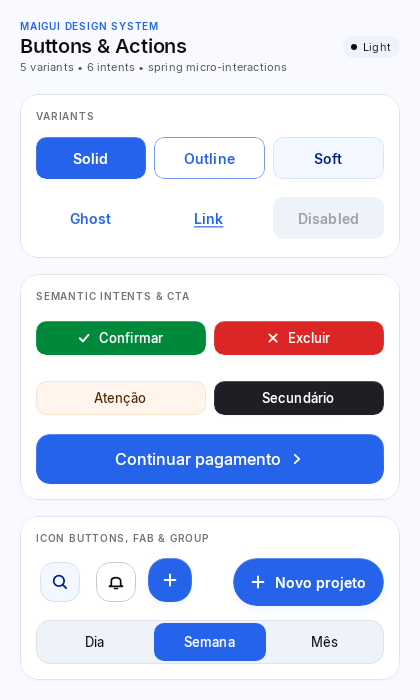
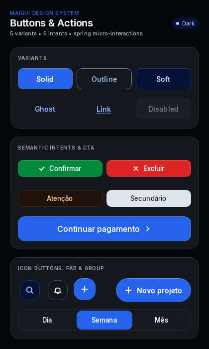
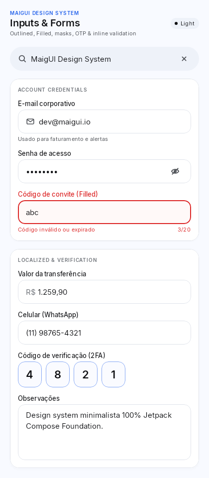
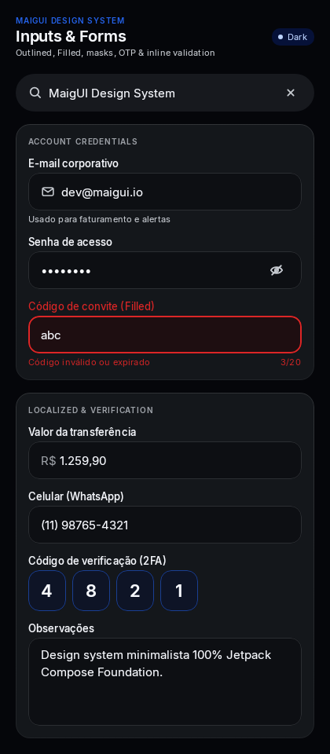
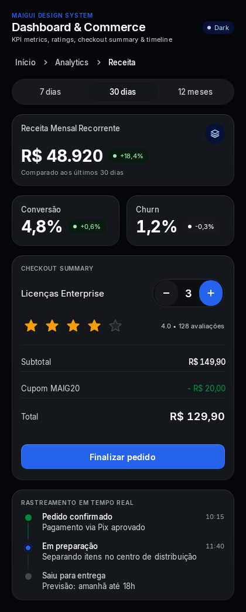

<div align="center">

<br/>

# MaigUI

### Enterprise-grade, Bootstrap-style Design System & UI Component Library for Jetpack Compose

Add one dependency, wrap your app in `MaigTheme {}`, and ship cohesive, accessible, modern Android UIs across every project — **100% built on `androidx.compose.foundation`** with zero Material 3 visual lock-in.

[](https://github.com/Maignardi/MaigUI/actions/workflows/ci.yml)
[](https://central.sonatype.com/artifact/io.github.maignardi/maig-ui)
[](LICENSE)
[](gradle/libs.versions.toml)
[](gradle/libs.versions.toml)
[](gradle/libs.versions.toml)

[Interactive Explorer & Docs](https://maignardi.github.io/MaigUI/) • [Installation](#-installation) • [Visual Gallery](#-visual-gallery-light--dark) • [Recipes](#-production-recipes) • [Components](#-component-catalog)

</div>

---

## Architecture & Highlights

```text
  Your Android App (:app)
          │
          ├──▶ maig-ui-forms  (rememberMaigForm, CPF/CNPJ/CEP/Phone masks & validators)
          │         │
          │         ▼
          └──▶ maig-ui        (45+ Compose Foundation components, MaigScaffold, MaigIcons)
                    │  (exposed transitively via `api`)
                    ▼
               maig-ui-core   (@Immutable tokens, OKLCH WCAG AA generator, 10 presets, Inter OFL)
```

| Feature | Why teams choose MaigUI |
| :--- | :--- |
| **Pure `foundation` rendering** | Zero Material 3 visual look-and-feel — generous rounded corners (`14dp–24dp`), subtle gradient dark-mode borders, spring press feedback, and soft focus halos. |
| **Single-color OKLCH Engine** | Pass `MaigBrand(primary = Color(...))` to generate 50–900 scales and Light/Dark palettes with **guaranteed `>= 4.5:1` WCAG AA** `"on"` colors. |
| **10 Designer Presets** | `Default` (Blue), `Indigo`, `Purple`, `Rose`, `Crimson`, `Orange`, `Amber`, `Green`, `Teal`, `Slate` — or any custom hex color. |
| **Bundled Inter Typography** | Regular, Medium, SemiBold, and Bold (SIL OFL 1.1) included in `res/font`, with a 1-line `fontFamily` override. |
| **Brazilian Forms & Masks** | `rememberMaigForm {}` with `rememberSaveable` rotation survival, automatic `ImeAction.Next`/`Done` chaining, mod-11 CPF/CNPJ validation, CEP, phone, and BRL currency. |
| **Production Quality Gates** | `explicitApi()`, Binary Compatibility Validator (`apiCheck`), Dokka HTML/Javadoc, Android Lint, Unit + Compose UI tests, and Roborazzi Light/Dark screenshot tests. |

---

## Visual Gallery (Light & Dark)

> Every screenshot below is rendered directly from our Android Jetpack Compose engine via **Roborazzi** (`./gradlew :maigui-components:verifyRoborazziDebug`).

<table>
  <tr>
    <th>Buttons &amp; Actions (Light)</th>
    <th>Buttons &amp; Actions (Dark)</th>
  </tr>
  <tr>
    <td align="center"></td>
    <td align="center"></td>
  </tr>
  <tr>
    <th>Inputs &amp; Specialized Fields (Light)</th>
    <th>Inputs &amp; Specialized Fields (Dark)</th>
  </tr>
  <tr>
    <td align="center"></td>
    <td align="center"></td>
  </tr>
  <tr>
    <th>Selection &amp; Pickers (Light)</th>
    <th>Selection &amp; Pickers (Dark)</th>
  </tr>
  <tr>
    <td align="center"></td>
    <td align="center"></td>
  </tr>
  <tr>
    <th>Overlays &amp; Feedback (Light)</th>
    <th>Overlays &amp; Feedback (Dark)</th>
  </tr>
  <tr>
    <td align="center"></td>
    <td align="center"></td>
  </tr>
  <tr>
    <th>Display &amp; Navigation (Light)</th>
    <th>Display &amp; Navigation (Dark)</th>
  </tr>
  <tr>
    <td align="center"></td>
    <td align="center"></td>
  </tr>
  <tr>
    <th>Modern Dashboard &amp; Extras (Light)</th>
    <th>Modern Dashboard &amp; Extras (Dark)</th>
  </tr>
  <tr>
    <td align="center"></td>
    <td align="center"></td>
  </tr>
</table>

---

## Installation

All MaigUI artifacts are published on **Maven Central** (`mavenCentral()`).

Add the desired modules to your app's `build.gradle.kts`:

```kotlin
dependencies {
    // Full UI kit (MaigTheme + 45+ components + MaigIcons; exposes maig-ui-core transitively)
    implementation("io.github.maignardi:maig-ui:0.1.0")

    // Optional: Declarative forms, Brazilian masks (CPF/CNPJ/CEP/Phone/BRL) & validators
    implementation("io.github.maignardi:maig-ui-forms:0.1.0")

    // Optional: Design tokens, WCAG AA OKLCH theme engine & Inter typography only
    implementation("io.github.maignardi:maig-ui-core:0.1.0")
}
```

### Published Modules

| Module | Maven Central Coordinate | Purpose |
| :--- | :--- | :--- |
| `maigui-core` | `io.github.maignardi:maig-ui-core:0.1.0` | `@Immutable` tokens, OKLCH palette generator, WCAG AA utilities, 10 presets, Inter font |
| `maigui-components` | `io.github.maignardi:maig-ui:0.1.0` | 45+ UI components + `MaigIcons` (exposes `maig-ui-core` via `api`) |
| `maigui-forms` | `io.github.maignardi:maig-ui-forms:0.1.0` | `rememberMaigForm`, validators (CPF, CNPJ, CEP, BR Phone, etc.), `MaigMasks` |
| `sample` | *(not published)* | Interactive catalog & test app with real-time Light/Dark and brand color switching |

---

## Quick Start (30 Seconds)

Wrap your root UI in `MaigTheme {}` and build screens with `MaigScaffold`:

```kotlin
class MainActivity : ComponentActivity() {
    override fun onCreate(savedInstanceState: Bundle?) {
        super.onCreate(savedInstanceState)
        enableEdgeToEdge()
        setContent {
            MaigTheme(preset = MaigThemes.Indigo) {
                DashboardScreen()
            }
        }
    }
}

@Composable
fun DashboardScreen() {
    val toast = LocalMaigToastState.current

    MaigScaffold(
        topBar = { MaigTopBar(title = "Overview") },
    ) { padding ->
        Column(
            modifier = Modifier
                .padding(padding)
                .padding(MaigTheme.spacing.lg),
            verticalArrangement = Arrangement.spacedBy(MaigTheme.spacing.md),
        ) {
            MaigStatCard(
                label = "Monthly Revenue",
                value = "R$ 48.920",
                delta = "+18,4%",
                trend = MaigStatTrend.Positive,
                subtitle = "Last 30 days",
            )
            MaigButton(
                text = "Create Report",
                onClick = { toast.showSuccess("Report generated!") },
                fullWidth = true,
            )
        }
    }
}
```

---

## Theme & Token Customization

### 1. Generate a full palette from one color

```kotlin
MaigTheme(
    brand = MaigBrand(primary = Color(0xFF0D9488)), // generates 50–900 scales + Dark Mode + WCAG AA
    darkTheme = isSystemInDarkTheme(),               // optional manual override: true / false
) { /* ... */ }
```

### 2. Swap the font family

```kotlin
val MyBrandFont = FontFamily(Font(R.font.plus_jakarta_sans))

MaigTheme(
    preset = MaigThemes.Purple,
    fontFamily = MyBrandFont, // updates all 10 typography styles automatically
) { /* ... */ }
```

### 3. Access tokens anywhere

```kotlin
MaigTheme.colors      // primaryDefault, primarySubtle, surface, surfaceElevated, textPrimary, border, dangerDefault...
MaigTheme.typography  // displayLarge, displayMedium, headline, title, subtitle, body, bodySmall, label, caption, button
MaigTheme.spacing     // xxs(2), xs(4), sm(8), md(12), lg(16), xl(24), xxl(32), xxxl(48)
MaigTheme.shapes      // none(0), xs(6), sm(10), md(14), lg(18), xl(24), full(pill)
MaigTheme.elevation   // none(0), xs(1), sm(2), md(4), lg(8), xl(16)
```

---

## Production Recipes

### Checkout / Summary Card

```kotlin
MaigCard(variant = MaigCardVariant.Elevated) {
    MaigKeyValueRow(label = "Subtotal", value = "R$ 149,90", showDivider = true)
    MaigKeyValueRow(
        label = "Cupom MAIG20",
        value = "- R$ 20,00",
        valueColor = MaigTheme.colors.successDefault,
        showDivider = true,
    )
    MaigKeyValueRow(label = "Total", value = "R$ 129,90", emphasizeValue = true)
    MaigSpacer.md()
    MaigButton(text = "Finalizar Pedido", onClick = onCheckout, fullWidth = true)
}
```

### Declarative Brazilian Form (`maigui-forms`)

```kotlin
val form = rememberMaigForm {
    field("email") { required(); email() }
    field("cpf") { required(); cpf() }
    field("cep") { required(); cep() }
    field("telefone") { required(); phone() }
    field("senha") { required(); minLength(8) }
    field("confirmar") { required(); matches("senha", "Senhas não conferem") }
}

MaigTextField(field = form["email"], label = "E-mail")
MaigTextField(field = form["cpf"], label = "CPF", visualTransformation = MaigMasks.cpf())
MaigTextField(field = form["cep"], label = "CEP", visualTransformation = MaigMasks.cep())
MaigPhoneField(field = form["telefone"])
MaigPasswordField(field = form["senha"], label = "Senha")
MaigPasswordField(
    field = form["confirmar"],
    label = "Confirmar senha",
    onSubmit = { if (form.validate()) submit(form.values) },
)
```

---

## Component Catalog

| Category | Components |
| :--- | :--- |
| **Buttons** | `MaigButton` (`Solid`, `Outline`, `Ghost`, `Soft`, `Link` × 6 colors × 3 sizes, loading, icons, `fullWidth`, spring press), `MaigIconButton`, `MaigFab`, `MaigButtonGroup` |
| **Inputs** | `MaigTextField` (`Outlined`, `Filled`, focus halo, helper/error, counter), `MaigPasswordField`, `MaigSearchField`, `MaigTextArea`, `MaigOtpField`, `MaigMoneyField` (`R$`), `MaigPhoneField`, `MaigNumberStepper` |
| **Selection** | `MaigCheckbox`, `MaigTriStateCheckbox`, `MaigRadioButton`, `MaigRadioGroup`, `MaigSwitch`, `MaigChip` (`Filter`, `Choice`, `Input`), `MaigSelect` (searchable), `MaigSlider`, `MaigRangeSlider`, `MaigRating`, `MaigDatePicker`, `MaigTimePicker` |
| **Overlays & Feedback** | `MaigDialog`, `MaigAlertDialog`, `MaigConfirmDialog`, `MaigBottomSheet`, `MaigPopover`, `MaigTooltip`, `MaigDropdownMenu`, `MaigToastHost` + `rememberMaigToastState()`, `MaigAlert`, `MaigSpinner`, `MaigLoadingOverlay`, `MaigLinearProgressBar`, `MaigCircularProgressBar`, `MaigSkeleton` (`Circle`, `Text`, `Card`) |
| **Display** | `MaigCard` (`Elevated`, `Outlined`, `Filled`, clickable), `MaigStatCard`, `MaigKeyValueRow`, `MaigTimeline`, `MaigAvatar`, `MaigAvatarGroup`, `MaigBadge`, `MaigBadgedBox`, `MaigTag`, `MaigDivider`, `MaigListItem`, `MaigEmptyState`, `MaigAccordion` |
| **Navigation** | `MaigTopBar`, `MaigBottomNavigation`, `MaigSegmentedControl`, `MaigBreadcrumb`, `MaigTabs` (`Underline`, `Pill`, fixed & scrollable), `MaigStepper`, `MaigModalNavigationDrawer`, `MaigPagination` |
| **Layout & Icons** | `MaigScaffold` (integrated `MaigToastHost`), `MaigSpacer` (`xxs`..`xxxl`), `MaigSection`, `MaigIcons` |

---

## Running & Contributing Locally

```bash
# Run all unit, forms, and catalog UI tests
./gradlew :maigui-core:testDebugUnitTest :maigui-forms:testDebugUnitTest :sample:testDebugUnitTest

# Verify Roborazzi screenshots (12 Light & Dark sheets)
./gradlew :maigui-components:verifyRoborazziDebug

# Verify binary public API compatibility
./gradlew apiCheck

# Run Android Lint & build sample catalog APK
./gradlew lint :sample:assembleDebug

# Generate Dokka API docs & publish to ~/.m2
./gradlew dokkaGeneratePublicationHtml publishToMavenLocal
```

Open [`docs/index.html`](docs/index.html) in any browser or visit https://maignardi.github.io/MaigUI/ for the interactive documentation explorer.

---

## License

Licensed under the [Apache License 2.0](LICENSE).  
Bundled Inter font files are licensed under the [SIL Open Font License 1.1](maigui-core/INTER_OFL_LICENSE.txt).
